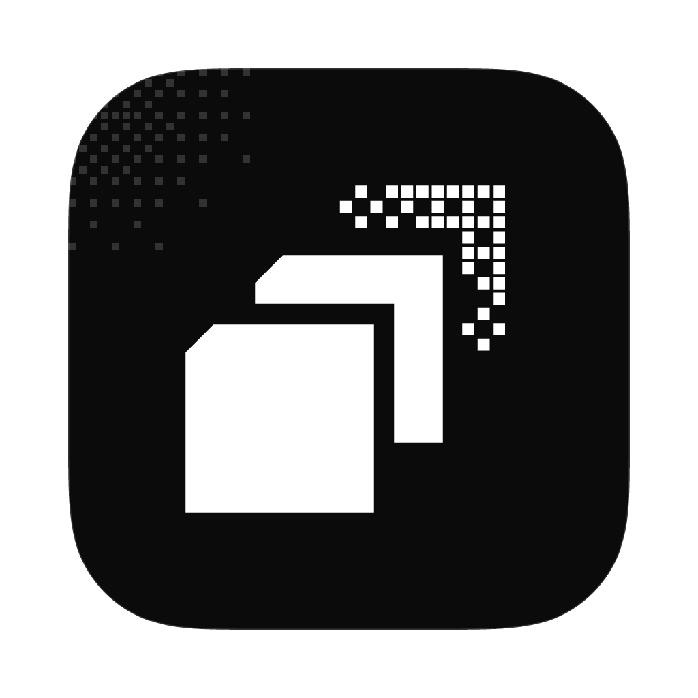

<p align="center">
  
</p>

<h1 align="center">nori</h1>

<p align="center"><strong>Images, vectors and page layout in one app, drivable by your AI.</strong></p>

<p align="center"><strong>Status:</strong> Beta · v0.3.0 · Linux and macOS</p>

<p align="center">
  <a href="https://lsuite.xyz/nori">Website</a> ·
  <a href="https://lsuite.xyz/nori/download">Download</a> ·
  <a href="docs/README.md">Documentation</a> ·
  <a href="CHANGELOG.md">Changelog</a>
</p>

<p align="center">
  
</p>

nori retouches photos with layers, masks and adjustment layers, draws with the pen, shapes and
gradients, and lays out posters and booklets with text that flows from page to page, in one
window, with one undo history your AI agent shares. It is for designers, photographers and anyone
who wants an agent to do design work with them. It is a native Rust app, free and open source
(MIT), and part of [lsuite](https://lsuite.xyz), a suite of four free, open-source apps (kimchi,
ryolune, nori and folio).

## What it does

- **Photos and painting.** PNG, JPEG, WebP, TIFF, BMP, GIF; pixel layers with blend modes,
  opacity, masks and clipping; adjustment layers (Levels, Curves with a draggable graph,
  Hue/Saturation, Exposure, Brightness/Contrast, Vibrance, Black & White, Invert, Threshold,
  Posterize, and Color Lookup from `.cube` files); brush and eraser (hardness, flow, pressure, GIMP
  brush tips); paint bucket, gradients; selections (rectangle, ellipse, lasso, magic wand, from a
  layer; grow, shrink, feather); filters (Gaussian and motion blur, sharpen, noise, pixelate);
  crop, image and canvas size, transforms.
- **Drawings.** Shapes with live corners (rectangle, ellipse, polygon, star, line), the pen for
  Bézier paths and direct selection of their points, fills, strokes, dashes and gradients, path
  operations (unite, subtract, intersect, exclude). SVG in and out.
- **Pages.** Several pages or artboards in one document, master pages, margins, columns and
  guides; text frames whose words flow from frame to frame across pages; paragraph and character
  styles; page numbers; PDF export with every page, vector shapes and selectable text.
- **Documents and originals.** Several documents in tabs, each with its own undo history. Smart
  objects keep their editable source, so repeated resizing samples the original.
- **Coming from another editor.** Photoshop documents open with their layers (also what Affinity
  Photo, Pixelmator Pro and Photopea save), and layered PSD export; OpenRaster from Krita and GIMP;
  8-bit RGB and grayscale GIMP XCF (versions 0–13); PDF and PDF-compatible Illustrator files; IDML
  in and out; SVG from Illustrator, Inkscape, Figma, Affinity Designer, Canva and Scribus. Adobe
  swatches (`.ase`) and GIMP brushes (`.gbr`) import too.
- **An open file.** A `.nori` document is a zip of `document.json` and PNGs: open it with any zip
  tool. See [FILE_FORMAT.md](docs/FILE_FORMAT.md).

## Getting it

nori runs on **Linux** (x86_64: AppImage or `.deb`) and **macOS** (Apple Silicon and Intel;
signed and notarized).

**Download:** [lsuite.xyz/nori/download](https://lsuite.xyz/nori/download). nori comes through the
lsuite app, which installs and updates every lsuite app from its signed builds, with no account.
Once installed, nori updates itself from Settings → Updates; checksums and signatures are verified
before anything is installed.

### Building from source

Rust 1.92 or later. Linux needs GPUI's usual system libraries (the list is in
[`.github/workflows/ci.yml`](.github/workflows/ci.yml)).

```sh
cargo run -p nori                 # the app
cargo run -p nori-cli -- --help   # the CLI
scripts/bundle-linux.sh           # the AppImage and .deb
scripts/bundle-macos.sh           # nori.app, a .dmg and the updater's .app.tar.gz (on a Mac)
```

## Usage

Open a picture, a Photoshop or Illustrator file, or start from a screen or print preset; every
tool, panel and export is in the window. Every action in the window is also a named command
([COMMANDS.md](docs/COMMANDS.md)), shared by the built-in agent, `nori-cli` and `nori-mcp`.

### From AI and scripts

The Agent panel (⌘J) runs the model you already have: your own Claude Code, Codex, an Anthropic
or OpenAI key, or a model on Ollama or any OpenAI-compatible server. Each change is a step you can
undo, and a run can be reverted at once. Every agent, built-in or connected over MCP, gets the same
harness: a designer's brief, eleven skills (poster, retouch, logo, booklet, brand kit…), a live
view of the document before each step, and `harness.look` / `harness.check` to see and measure the
work (contrast, bleed, resolution, overflow) before it says it is done.

```sh
claude mcp add nori -- /Applications/nori.app/Contents/MacOS/nori-mcp --live      # Claude Code (macOS path)
nori-cli mcp-config                                                               # the setup for Claude Code, Codex, Cursor and Claude Desktop
nori-cli --file poster.nori agent "Make an A3 poster for …" --provider claude-code  # the built-in agent, without the window
```

See [AI_CONTROL.md](docs/AI_CONTROL.md) for the Agent panel, `nori-mcp`, `nori-cli` and the
bridge, and [evals/RESULTS.md](evals/RESULTS.md) for the agent's scores on real design jobs.

### Plugins

Filters written in Rust with the nori SDK (`crates/nori-plugin`, see its
[guide](crates/nori-plugin/GUIDE.md)) load without a restart. Describe one in Plugins › Build with
your agent and the agent writes, builds and installs it. Two examples ship in
[`plugins/`](plugins): Duotone and Halftone.

### With the rest of lsuite

Send a picture straight to kimchi's timeline (`handoff.toKimchi`); nori tells the other lsuite
apps it is here (`~/.lsuite/apps/nori.json`).

## Documentation

- [docs/README.md](docs/README.md): the documentation index
- [AI_CONTROL.md](docs/AI_CONTROL.md): driving nori from agents and scripts
- [COMMANDS.md](docs/COMMANDS.md): every command, generated from the registry
- [FILE_FORMAT.md](docs/FILE_FORMAT.md): the `.nori` file
- [crates/nori-plugin/GUIDE.md](crates/nori-plugin/GUIDE.md): writing a plugin
- [CHANGELOG.md](CHANGELOG.md): what each release brought

## Project status and roadmap

nori is in **beta**: expect rough edges, and keep copies of work you care about. The current
version is 0.3.0. Ready-made builds are published for Linux and macOS; **Windows is coming soon**
(its code stays in the source, but no Windows builds are published).

Known limitations:

- **Interoperability.** PSD export keeps raster layers, names, opacity and supported blending;
  text, vector and effect layers are exported rendered. IDML export keeps simple text frames,
  threading, paths and embedded pictures; complex effects are rasterized. These round trips are
  covered by automated tests but have not yet been opened in Photoshop or InDesign. PDF import
  converts text to outlines. Illustrator import needs PDF compatibility; private Illustrator
  editing data and legacy PostScript `.ai` files are not supported.
- **XCF.** Import supports 8-bit nonlinear RGB and grayscale, groups, masks and raw, RLE and zlib
  tiles through version 13. Other precisions, indexed colour, unsupported blend modes and newer
  versions give a clear error; export OpenRaster from GIMP for those documents.
- **Pen pressure.** macOS reads tablet pressure from native tablet events; real tablet hardware
  still needs verification. On Linux the canvas uses full pressure, because the GUI backend does
  not expose tablet samples. The command API accepts pressure samples on every platform.
- **Smart objects.** Rotation, flipping and destructive pixel filters need the object rasterized
  first; to apply edits to the source, save the source tab and replace the contents.

Next on the roadmap: Windows builds, tablet pressure on Linux, and checking the PSD and IDML round
trips in Photoshop and InDesign.

## Contributing

Issues and pull requests are welcome on
[GitHub](https://github.com/ludovic111/nori/issues). A feature starts as a command in the
registry (`crates/nori-control`), so the window, the agent, the CLI and MCP get it together.
Before a pull request, run `cargo test --workspace` and
`cargo clippy --workspace --all-targets -- -D warnings`; after changing a command, regenerate
`docs/COMMANDS.md` with `cargo run -p nori-cli -- docs`.

```
crates/
  nori-core       the document model: canvas, layers, masks, selection, one undo history, the .nori file format
  nori-render     the renderer: tiled compositing, blend modes, adjustments, filters, the brush engine, transforms and text
  nori-io         pictures in and out, PSD, OpenRaster, XCF, SVG, PDF and IDML, brushes and swatches
  nori-control    the command registry shared by the window, the agent, the CLI and MCP
  nori-agent      the built-in agent: the person's own model (Claude Code, Codex, API keys, local) over the registry
  nori-plugin     the plugin SDK: a frozen C ABI for filters that work on RGBA f32 tiles with typed parameters
  nori-desktop    the window (GPUI), binary `nori`
  nori-cli        `nori-cli`: every registry command, on the running app or on a .nori file
  nori-mcp        `nori-mcp`: a Model Context Protocol server (stdio), every registry command is a tool
  nori-release    signs update archives and writes latest.json
evals/            the agent evals: design jobs run headless with a real model, scored automatically
plugins/          example plugins: duotone, halftone
```

## License

MIT. See [LICENSE](LICENSE). Fonts: Chakra Petch, Manrope and IBM Plex Mono (SIL OFL). Icons:
Lucide (ISC). The logos in `crates/nori-desktop/assets/logos` belong to their owners
([sources](crates/nori-desktop/assets/logos/SOURCES.md)).

nori is free, with no account and nothing to buy. If it helps you, you can
[support it](https://lsuite.xyz/nori/support) with an optional donation.

---

Made by [Ludovic Marie](https://lu4ovic.com) · [github.com/ludovic111](https://github.com/ludovic111)
